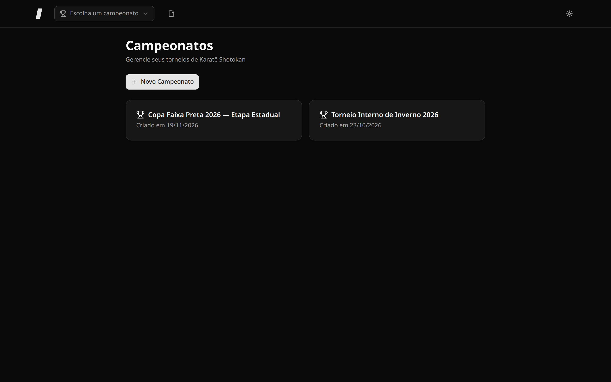
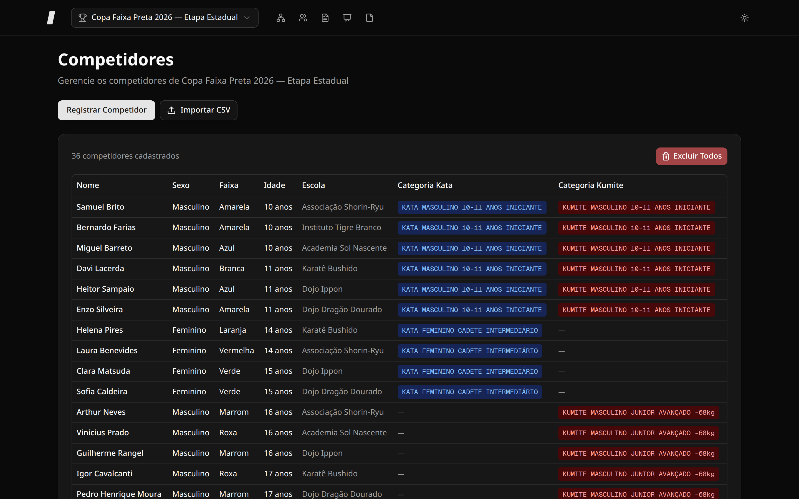
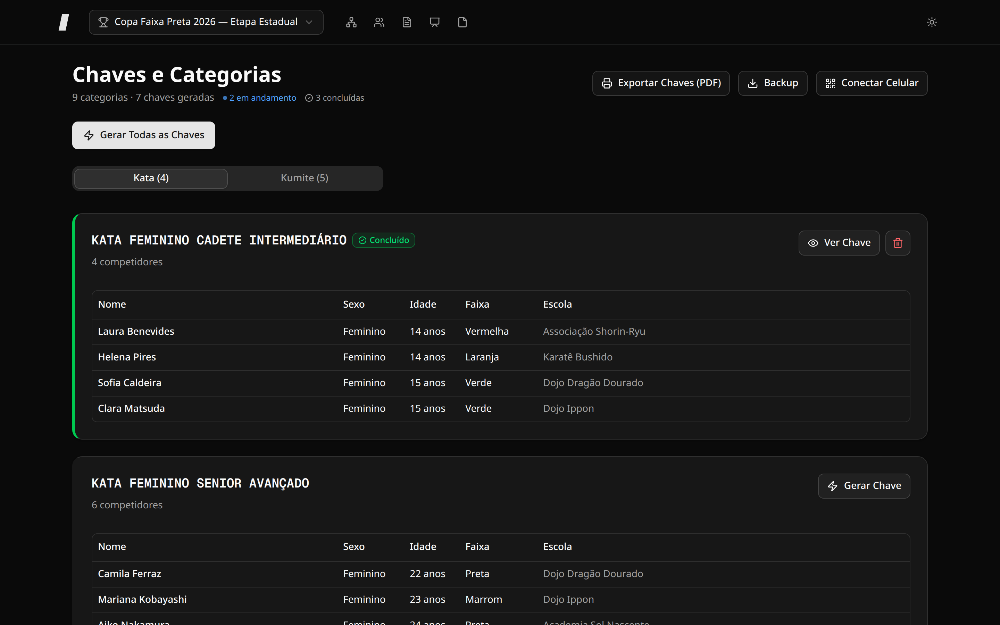
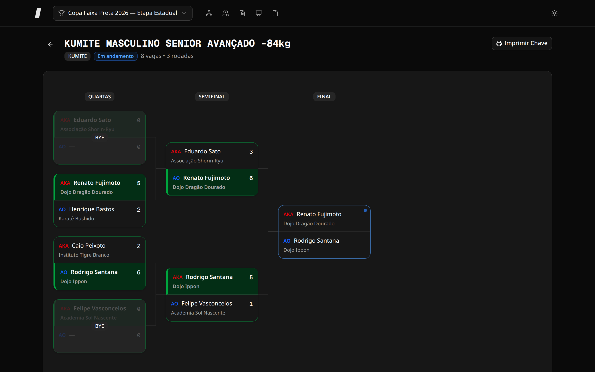
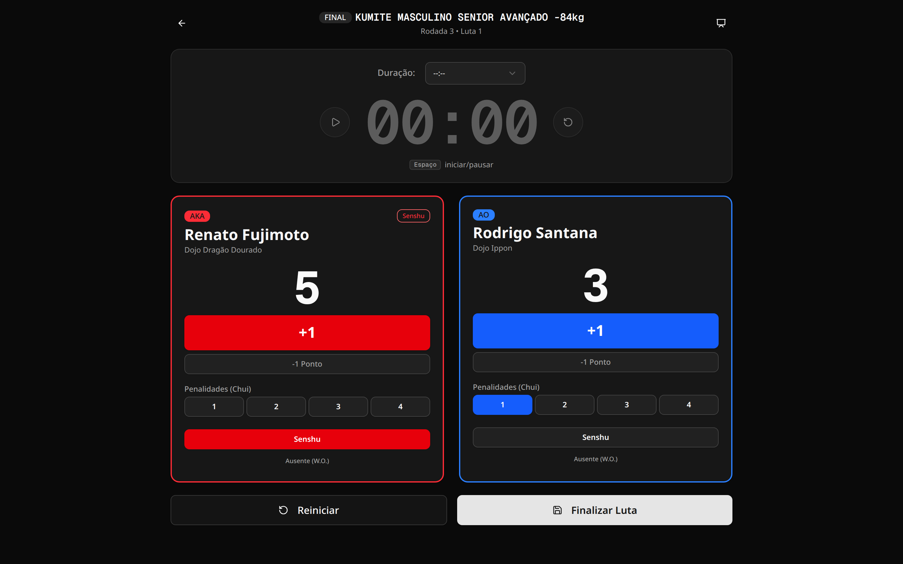
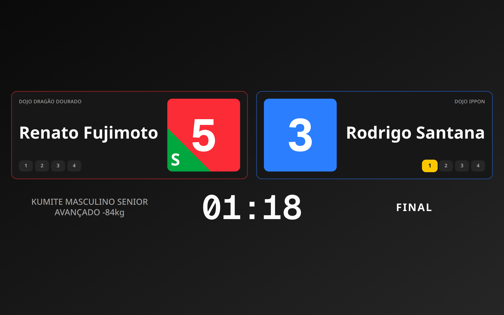
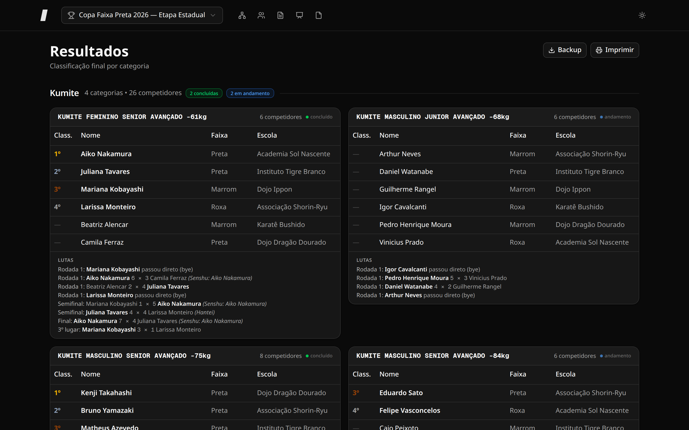
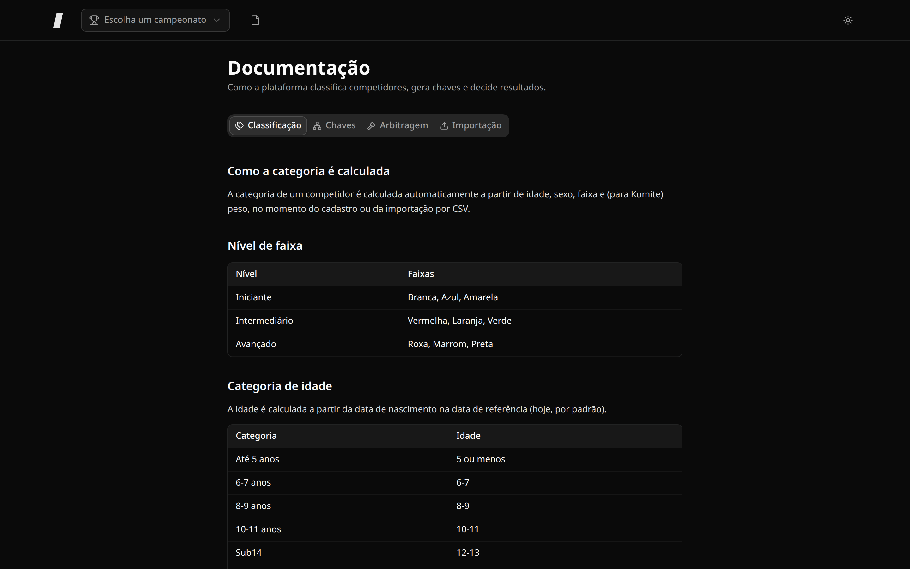

# Faixa Preta Cup

Plataforma para gerenciar torneios de karatê: cadastro de competidores, classificação automática por faixa/idade/peso, geração e arbitragem de chaves (Kata e Kumite), múltiplos árbitros na rede local via QR Code, placar ao vivo (telão) e relatório oficial de resultados em PDF.

Sem login — qualquer pessoa com acesso à URL do app consegue operar. Pensado para ser usado por uma equipe pequena (organização + árbitros) na rede local do evento.

## Capturas de tela

### Campeonatos
Tela inicial para criar e alternar entre campeonatos.



### Competidores
Cadastro manual, importação em lote (`.csv` / `.xlsx`) e classificação automática de categorias de **Kata** e **Kumite** por sexo, idade, faixa e peso.



### Categorias e Chaves
Visão geral de todas as categorias por modalidade, geração de chaves (individual ou em lote), exportação em PDF, backup JSON e conexão de celulares de árbitros via QR Code.



### Visualização da Chave
Árvore de eliminação simples com *byes* automáticos, separação anti-colisão de mesma academia na 1ª rodada, placares, destaque dos vencedores, disputa de 3º lugar e impressão da chave.



### Painel de Arbitragem
Controle completo da luta (AKA × AO) com cronômetro configurável (`Espaço` inicia/pausa), **Senshu**, penalidades (**Chui**), decisão por **Hantei**, **Ausente (W.O.)** e *lock* de mesa para evitar edição simultânea por dois árbitros.



### Scoreboard Público (Telão)
Tela pública sem interação, sincronizada em tempo real via SSE com o painel do árbitro, pensada para projeção ou TV no tatame.



### Resultados e Relatório Oficial
Classificação final por categoria (1º ao 4º lugar + histórico completo de lutas), atualizada automaticamente, com backup em JSON e impressão em PDF (sempre em modo claro).



### Documentação In-App
Guia integrado no menu (`/app/docs`) com regras de classificação, geração de chaves, arbitragem e formato de importação — referência rápida durante o evento.



---

## Stack

- **Next.js 15** (App Router) + **React 19** + **TypeScript**
- **Prisma** + **SQLite** (arquivo local, sem serviço de banco externo)
- **Tailwind CSS 4** + **Radix UI** (shadcn) + **Motion**
- `react-hotkeys-hook` (atalhos de teclado), `react-markdown` (aba de documentação), `papaparse` e `xlsx` (importação de CSV/planilhas), `qrcode.react` (conexão de árbitros na rede local)
- **Vitest** (testes automatizados)

## Rodando localmente

```bash
pnpm install                  # o postinstall já roda "prisma generate"
cp .env.example .env          # ajuste DATABASE_URL / NEXT_PUBLIC_HOSTNAME se precisar
pnpm dlx prisma migrate dev   # aplica as migrations no banco local (prisma/local.db)
pnpm db:seed                  # (opcional) popula o banco com dados fictícios de demonstração
pnpm dev
```

Abre em `http://localhost:3000`.

### Populando com dados fictícios (Seed)

Para testar ou demonstrar a plataforma rapidamente, execute:

```bash
pnpm db:seed
```

O script [prisma/seed.mjs](prisma/seed.mjs) limpa o banco local e cria 2 torneios fictícios com 42 competidores, 8 chaves (concluídas, em andamento e não iniciadas), histórico de lutas com *byes*, *Senshu*, *Hantei* e *W.O.*, além de uma luta ativa no `LiveMatch` para o Scoreboard.

### Testes

```bash
pnpm test        # executa a suíte de testes uma vez (Vitest)
pnpm test:watch  # modo watch
```

### Banco de dados

O projeto usa **migrations do Prisma** em desenvolvimento (histórico versionado em `prisma/migrations/`):

```bash
npx prisma migrate dev      # cria/aplica migrations a partir de mudanças no schema.prisma
npx prisma migrate status   # confere se o banco local está em dia com o schema
npx prisma generate         # regenera o Prisma Client (roda sozinho no postinstall)
```

> Depois de rodar uma migration com o `pnpm dev` já aberto em outro terminal, **reinicie o `pnpm dev`**. O client do Prisma é guardado em `globalThis` de propósito (evita estourar conexões no hot-reload do Next), então o processo não pega o client regerado sozinho — só reiniciando.

Em produção (Docker), não são as migrations que rodam — veja "Deploy (Docker)" abaixo.

## Deploy (Docker)

```bash
docker compose up -d --build
```

O `Dockerfile` builda o Next em modo `standalone` e o `docker-compose.yml` usa `network_mode: host` para expor o servidor diretamente no IP da rede local/Wi-Fi da máquina — permitindo que celulares dos árbitros se conectem escaneando o QR Code em **Conectar Celular**.

No `entrypoint.sh`, o container roda **`prisma db push --accept-data-loss --skip-generate`** contra `/data/local.db` (volume persistente `db_data`, ver `docker-compose.yml`) antes de subir o servidor — sincronizando o schema diretamente sem depender do histórico de migrations na imagem final (`--skip-generate` porque o client já foi gerado no build). Isso funciona bem para deploy de container único no dia do evento, mas **é destrutivo em mudanças incompatíveis de schema**.

Variáveis de ambiente relevantes (ver `.env.example`):

- `DATABASE_URL` — caminho do arquivo SQLite (`file:./local.db` local, `file:/data/local.db` no container)
- `NEXT_PUBLIC_HOSTNAME` — URL pública do app (usada em metadata/Open Graph)

**Antes do dia do torneio**, faça um teste ponta-a-ponta com a imagem Docker (não só `pnpm dev`) — é o que efetivamente vai rodar no evento:

```bash
docker build -t faixa-preta-cup .
docker compose up -d
```

## Como operar um torneio

1. **Criar o campeonato** — tela inicial (`/app`), escolha um nome.
2. **Competidores** — cadastro manual ou importação em lote via `.csv` / `.xlsx` (o diálogo de importação mostra os campos e valores aceitos; ver também a aba Documentação → Importação no app). A categoria de Kata/Kumite é calculada automaticamente a partir de faixa, idade, sexo e peso.
3. **Categorias e Chaves** — gere as chaves por categoria (ou todas de uma vez). Eliminação simples, com *bye* automático quando o número de competidores não é potência de 2, separação anti-colisão de atletas da mesma escola/academia na 1ª rodada e disputa de 3º lugar quando há 4+ competidores. Também é possível **exportar/imprimir todas as chaves em PDF** e baixar um **backup completo em JSON**.
4. **Múltiplos Árbitros (QR Code + Lock de Mesa)** — clique em **Conectar Celular** na tela de chaves para gerar um QR Code apontando para o IP local do servidor. Cada chave possui um *lock* automático com *heartbeat* (`RefereeLock`) que evita que dois dispositivos arbitrem a mesma chave ao mesmo tempo (com opção de assumir o controle se necessário).
5. **Arbitragem** — abra uma luta pela chave. Placar manual, timer configurável (`Espaço` inicia/pausa), **Senshu** e **Chui** são informativos. Empate exige decisão por **Hantei**. Se um competidor faltar, use **Ausente (W.O.)** no card dele — diferente de *bye*, W.O. só existe quando os dois estavam escalados. O estado da luta é transmitido ao vivo (SSE) para o Scoreboard público.
6. **Scoreboard** — tela pública (pensada para telão/projeção), sem interação, mostra a luta em andamento em tempo real.
7. **Resultados** — classificação por categoria com pódio e histórico completo das lutas, atualiza sozinha, permite backup em JSON e impressão em PDF do relatório oficial (sempre em modo claro, mesmo com o app no tema escuro).
8. **Documentação** (`/app/docs`) — aba fixa no menu, sempre visível: explica classificação, geração de chaves, regras de arbitragem e formato de importação.

Atalho `Esc` volta para a tela anterior em quase todo o app — **exceto na tela de árbitro**, onde sair sem querer no meio de uma luta perderia o placar (lá o botão de voltar pede confirmação).

## Estrutura do projeto

```
src/app/api/tournaments/…              rotas da API (torneio, competidores, categorias, chaves, lock de árbitro, resultados, backup JSON)
src/app/api/live-match/…               estado da luta ao vivo e stream SSE para o Scoreboard
src/app/api/network-info/              detecção do IP na rede local para o QR Code dos árbitros
src/app/app/[tournamentId]/(private)/  telas de organização (competidores, categorias, chaves, árbitro)
src/app/app/[tournamentId]/(public)/   telas para exibição/impressão (scoreboard, resultados, impressão de chaves)
                                       ("private"/"public" são apenas grupos de rota do Next.js, sem auth)
src/app/app/docs/                      aba de documentação in-app
src/lib/utils/classification.ts        regras de categoria (faixa/idade/peso)
src/lib/utils/bracket-generator.ts     geração de chave (seeding, anti-colisão de escola, byes, 3º lugar)
src/__tests__/                         testes automatizados (Vitest)
prisma/schema.prisma                   modelo de dados SQLite
prisma/seed.mjs                        script de população com dados fictícios
docs/features-overview.md              diagramas do fluxo completo (apoio para apresentação)
docs/screenshots/                      capturas de tela usadas neste README
```

## Limitações conhecidas

- Sem autenticação — não exponha a URL publicamente sem alguma camada de rede (VPN, rede local do evento, etc.).
- SQLite em arquivo único — não é indicado para múltiplas instâncias do app escrevendo ao mesmo tempo.
- Chaves são de eliminação simples, sem repescagem.
- `pnpm lint` requer um `eslint.config.js` que não está versionado neste checkout — os demais scripts (`dev`, `build`, `test`, `db:seed`) não dependem disso.
