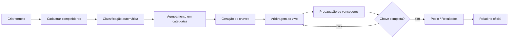
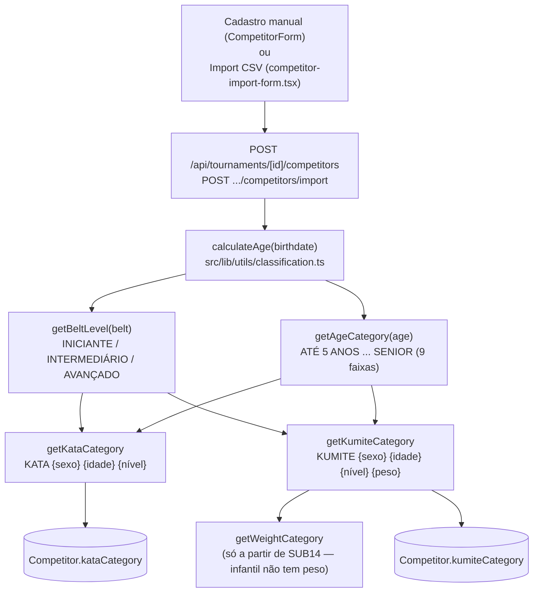
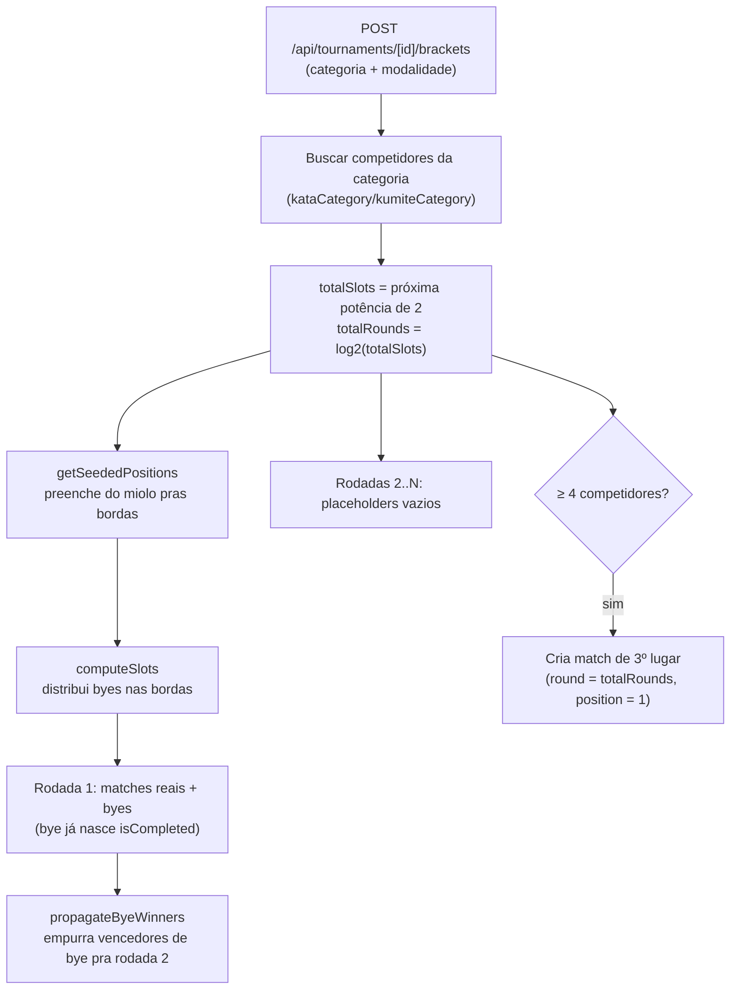
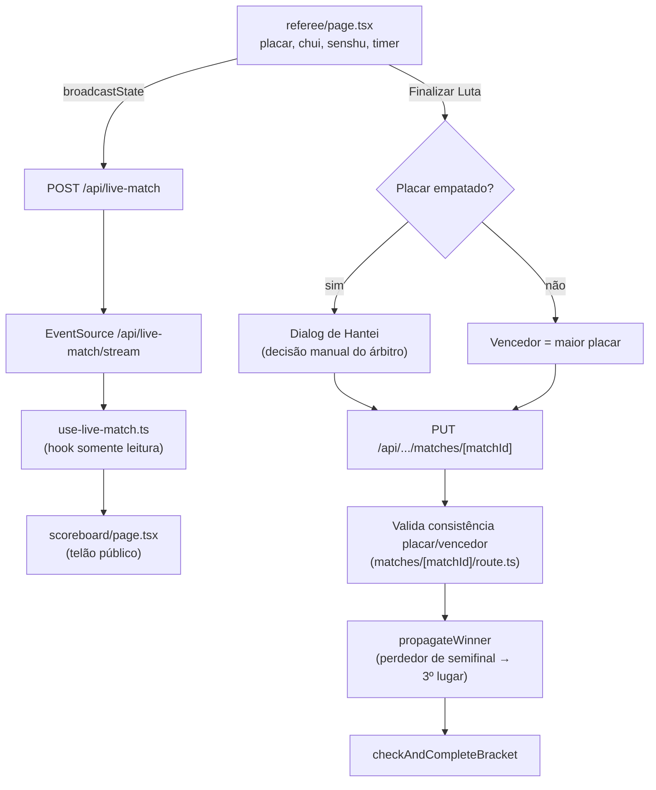
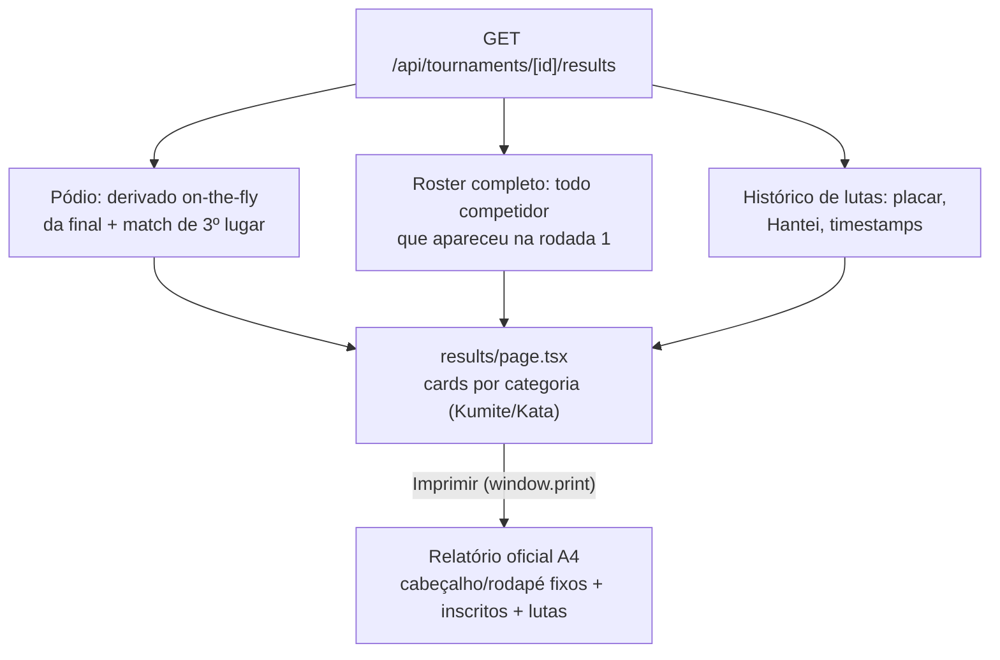

# Faixa Preta Cup — Visão Geral das Features

Esquema visual do funcionamento ponta-a-ponta da plataforma, para apoiar apresentações e onboarding. Cada diagrama referencia os arquivos reais que implementam o fluxo, para não desatualizar conforme o código evolui.

## 1. Fluxo geral do torneio

## 2. Cadastro de competidores e classificação automática

Cada competidor pode ser cadastrado manualmente ou em lote via CSV. Em ambos os casos, o sistema calcula automaticamente a categoria de Kata e/ou Kumite a partir de idade, sexo, faixa e peso — não há input manual de categoria.

**CSV aceito** (`competitor-import-form.tsx` + `.../competitors/import/route.ts`): colunas `nome, sexo, peso, nascimento, faixa, escola, kumite, kata`, com `sexo` em `masculino/feminino`, `nascimento` em `DD/MM/AAAA`, `faixa` em português e `kumite/kata` como `sim`/outro.

## 3. Geração de chaves (bracket-generator.ts)

Eliminação simples, com byes distribuídos das bordas para o miolo e disputa de 3º lugar quando há 4+ competidores.

## 4. Arbitragem ao vivo

A tela de árbitro mantém o estado da luta em memória e transmite via SSE para o placar público; o resultado só é persistido ao "Finalizar Luta".

Atalhos de teclado na tela de árbitro: `Espaço` inicia/pausa o timer. `Esc` para voltar funciona nas demais telas do app (`useEscBack`), mas foi deixado de fora do árbitro de propósito — lá, sair sem querer no meio de uma luta perderia o placar, então o botão de voltar pede confirmação em vez disso.

## 5. Resultados e relatório oficial

## Referências de código

| Etapa                          | Arquivo                                                                                                                                        |
| ------------------------------ | ---------------------------------------------------------------------------------------------------------------------------------------------- |
| Classificação                  | `src/lib/utils/classification.ts`                                                                                                              |
| Import de CSV                  | `src/components/competitor-import-form.tsx`, `src/app/api/tournaments/[id]/competitors/import/route.ts`                                        |
| Agrupamento em categorias      | `src/app/api/tournaments/[id]/categories/route.ts`                                                                                             |
| Geração de chaves              | `src/lib/utils/bracket-generator.ts`                                                                                                           |
| Arbitragem ao vivo             | `src/app/app/[tournamentId]/(private)/brackets/[bracketId]/referee/page.tsx`, `src/app/api/live-match/route.ts`, `src/hooks/use-live-match.ts` |
| Registro de resultado          | `src/app/api/tournaments/[id]/brackets/[bracketId]/matches/[matchId]/route.ts`                                                                 |
| Resultados / relatório oficial | `src/app/api/tournaments/[id]/results/route.ts`, `src/app/app/[tournamentId]/(public)/results/page.tsx`                                        |
